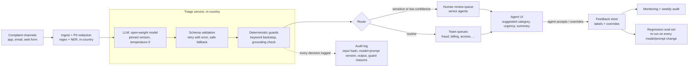

# Memo: Production rollout of LLM complaint triage

**To:** CTO, PayGuard · **From:** Consulting data scientist · **Re:** Taking complaint triage from prototype to production

## 1. Recommendation

Proceed with complaint triage first, in **shadow mode**, on a **self-hosted open-weight model inside the country**. It is the lower-risk launch of the two prototypes: every decision can start as a suggestion that a human checks, and the deterministic safety layer doesn't depend on the model behaving. In the prototype (500 real, public CFPB complaints, open-weight `gpt-oss-120b`): **0 schema failures in 100**; the safety layer escalated **100% of the prompt-injection attempts** and gave an **identical final escalation decision on 30/30 repeated runs**, even though the LLM alone changed its mind on 1 in 10. Paid inference would cost **≈ $11 per 50,000 complaints**. Routing accuracy against human labels is in the README. The model cost is small; the real costs and risks are data residency, human review capacity, and silent quality drift, which is what this memo addresses. Fraud scoring should follow once PayGuard can supply behavioural features from its own transaction stream (see Part A).

## 2. Architecture

Key properties:
- The **LLM never takes an irreversible action**. It suggests a route, and guards can only *add* escalation, never remove it.
- **Every decision is reproducible:** model version, prompt version, guard reasons and output are logged together.
- **Agent overrides are free labels:** each one feeds the next evaluation and retraining cycle.

## 3. Monitoring: what breaks silently

| Failure | How it shows up | Detection | Response |
|---|---|---|---|
| Model or provider update changes behaviour | Nothing fails; routes shift subtly | Pin model and prompt versions; re-run the labeled regression set on **every** change; block deploys that drop sensitive recall below 100% | Roll back to the pinned version |
| Category / urgency drift (new product, fraud wave, seasonality) | Queue volumes change | Weekly distribution dashboard per category and urgency, with alerts on large shifts vs. a 4-week baseline | Review the taxonomy; refresh the eval set |
| Rising schema failures / fallbacks | More "Other / unclear" | Alert if fallback rate > 1% per day, or if latency p95 breaches the SLA | Investigate prompt or model; fallbacks are safe (go to a human) but expensive |
| **Sensitive cases slipping through** | Invisible until a customer is harmed | Weekly random audit (~200 cases) by senior agents; track agent override rate per category; every audited miss is a P1 incident | Add guard rules; adjust the prompt; add the case to the regression set |
| Prompt injection attempts | Odd urgency/route on a few complaints | Log and alert on known patterns ("ignore previous instructions", fake delimiters); track the model's own injection notes | Guards already force escalation on fraud/legal content |
| Summary hallucination | Agents act on wrong facts | Automatic grounding check (numbers/dates not in the text); LLM-as-judge on a sample, **calibrated against human audits** | Show the original text next to the summary in the agent UI |

## 4. Data considerations

- **Residency:** customer complaints may not leave the country. That rules out foreign LLM APIs, including the hosted API used in the prototype on public US data. Options, in order of preference:
  1. A **self-hosted open-weight model** (the gpt-oss or Llama family) on GPUs in an in-country data centre or cloud region.
  2. A provider's in-country region, if one exists and contractually guarantees no data export or training use.
  The prototype's provider abstraction (`LLM_PROVIDER=ollama`, or any OpenAI-compatible endpoint) means switching is a configuration change, not a rewrite; the evaluation must be re-run on the chosen model.
- **PII:** redact before inference (regex for card/account/phone/email, plus a named-entity model for names and addresses). Encrypt in transit and at rest. Give role-based access to raw complaints.
- **Retention:** keep raw prompts/outputs for a short operational window (e.g. 90 days). Keep redacted decision records and audit logs for the regulatory period. Never use customer data for model training without legal sign-off.
- **Audit trail:** for every routing decision, store when, which model and prompt version, what the guards fired on, and who overrode it. That's what a regulator or ombudsman will ask for.

## 5. Phased rollout

| Phase | What the system does | Go / no-go to advance (on ≥ 4 weeks of real data) |
|---|---|---|
| **0. Shadow** (4–6 weeks) | LLM triages in the background; humans do everything as today; compare | Category accuracy ≥ 85% vs. agents; **sensitive recall = 100%** on audited cases; under-triage ≤ 5%; fallback ≤ 1% |
| **1. Assist** | LLM pre-fills category, urgency, summary; an agent approves every case | Agent override rate ≤ 15%; summaries rated faithful ≥ 95%; handling time down measurably |
| **2. Partial automation** | Auto-route high-confidence, **non-sensitive** cases; sensitive and low-confidence cases always go to a human | Weekly audit accuracy holds; zero sensitive misses; complaint escalation/reopen rate not worse than baseline |
| **3. Expand** | More categories automated; ongoing audits | Same thresholds, monitored continuously |

**Rollback criteria at any phase:** any sensitive miss confirmed in audit, sensitive recall < 100% on the regression set, or override rate > 2× its baseline. Each of these triggers an automatic return to the previous phase.

## 6. What we need from PayGuard

1. **Historical complaints with their final resolution and team**, ideally 6–12 months: the real taxonomy and the training/evaluation data. The prototype used US public data because PayGuard's wasn't available.
2. **A support-team subject-matter expert** (~2 days/week during Phases 0–1) to own the taxonomy and labeling guide, and to label a 500-case evaluation set.
3. **In-country GPU capacity** (one or two inference-class GPUs are enough for this volume) or an approved in-country cloud region.
4. **A compliance/legal contact** to sign off on residency, retention, the human-review policy and regulator reporting.
5. **An owner for the feedback loop:** someone accountable for the weekly audit and for acting on its results.
